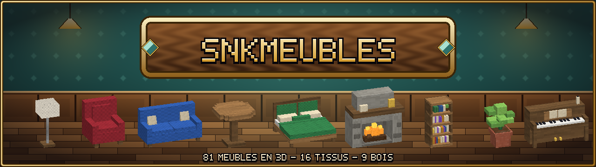
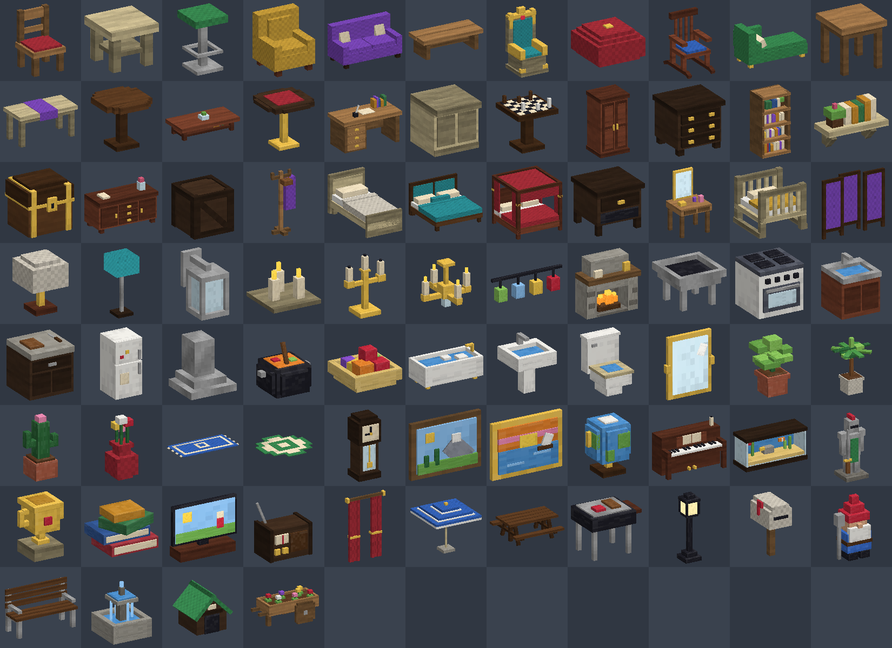
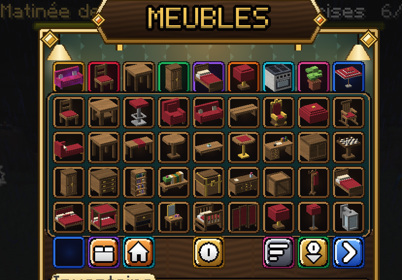
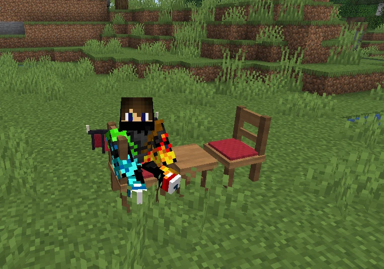

<b>81 meubles en 3D à acheter, poser et utiliser, avec leur boutique dessinée.</b> 
Plugin Minecraft pour serveurs <b>Paper 1.21.4 à 26.3</b>, par <b>SnkAlex</b>.

<a href="#-fonctions">Fonctions</a> •
<a href="#-les-81-meubles">Meubles</a> •
<a href="#-captures">Captures</a> •
<a href="#-commandes">Commandes</a> •
<a href="#-compatibilité">Compatibilité</a> •
<a href="#-lobtenir">L'obtenir</a>

---

## ✨ Fonctions

### 🛋️ Une boutique rien que pour les meubles
- **8 catégories**, chaque meuble montré avec son **vrai modèle 3D**
- Un **grand aperçu qui tourne** avant d'acheter
- **16 tissus et 9 bois** au choix, pour chaque meuble
- **Pièces complètes** (salon, chambre, cuisine, salle de bain, bureau, jardin…) avec une remise
- **Revente** d'un clic, et la liste de **ses meubles posés** pour les reprendre à distance

### 👻 Poser facilement
- Un **fantôme vert ou rouge** montre où le meuble va aller
- Clic droit pour poser, clic gauche pour tourner
- Au sol, **au mur ou au plafond**, et même **sur une table** (lampe, vase, livres…)
- Accroupi + clic droit : couleur, rotation, hauteur, privé ou partagé

### 🪑 Des meubles qui servent
- **S'asseoir** sur les chaises, canapés, bancs, la baignoire ou le trône, **à plusieurs**
- **Rangements** : armoires, commodes, coffres, frigo… privés par défaut
- **Lits** : point de réapparition, et la nuit passe quand assez de joueurs dorment
- **Lumières** qui éclairent vraiment : lampes, lustres, bougies, cheminée, lampadaires
- **Cuisine** : cuire sa viande sur la cuisinière, la marmite ou le barbecue
- Piano, radio, télé et horloge qui répondent au clic

### 🛡️ Sans risque pour le serveur
- Respecte les **protections** (régions, terrains, territoires de clan…)
- **Limites** par joueur, par grade et par zone, mondes interdits
- Les meubles n'existent que dans les zones chargées : **rien ne tourne** loin des joueurs

---

## 🏠 Les 81 meubles

| Catégorie | Nombre | Exemples |
|---|---|---|
| Assises | 10 | Chaise, fauteuil, canapé, trône, rocking-chair |
| Tables | 8 | Table ronde, bureau, comptoir, échiquier |
| Rangements | 8 | Armoire, commode, bibliothèque, coffre |
| Chambre | 7 | Lit double, baldaquin, coiffeuse, berceau |
| Lumières | 9 | Lampe, lustre, bougies, cheminée, brasero |
| Cuisine et bain | 11 | Cuisinière, évier, frigo, baignoire |
| Décorations | 18 | Plantes, tableaux, piano, aquarium, armure |
| Extérieur | 10 | Parasol, barbecue, fontaine, niche, charrette |

 Les 81 modèles, en couleurs au hasard (aperçu dessiné hors du jeu)

---

## 📸 Captures

 La boutique

 Assis à table

---

## ⌨️ Commandes

| Commande | Effet |
|---|---|
| `/meubles` (ou `/meuble`, `/furniture`) | La boutique |
| `/meubles lots` | Les pièces complètes |
| `/meubles poses` | Mes meubles posés |
| `/meubles admin donner <joueur> <meuble|tout>` | Donner des meubles (admin) |
| `/meubles admin info` · `retirer` · `reload` | Gestion (admin) |

**Permissions :** `snkmeubles.boutique`, `snkmeubles.poser`, `snkmeubles.admin`, `snkmeubles.limite.<nombre>`.

---

## 🧩 Compatibilité

| | |
|---|---|
| **Versions** | 1.21.4 à 26.3, un seul fichier pour toutes |
| **Testé sur** | Paper 1.21.4, 1.21.11, 26.2 et 26.3 |
| **Serveur** | Paper |
| **Java** | 21 ou plus (celui de ta version de Paper) |
| **Pack de ressources** | Obligatoire (fourni) : les joueurs sans le pack ne voient pas les meubles |
| **Conseillé** | Vault et une économie |

**Va plus loin avec les autres plugins Snk** (facultatifs) :
- **[SnkClans](https://github.com/SnkStudio/SnkClans)** : seuls les membres du clan meublent son territoire
- **[SnkMetiers](https://github.com/SnkStudio/SnkMetiers)** : de l'argent à gagner pour se meubler

---

## 📦 Ce que tu reçois
- Le plugin (`.jar`)
- Le pack de ressources : les 81 modèles et la boutique dessinée
- Le guide d'installation et le guide complet, en français

Aucune connaissance en code n'est nécessaire : noms, prix et pièces complètes se règlent dans des fichiers de texte.

---

## 📩 L'obtenir

Le plugin n'est pas en téléchargement libre. Pour le prix, une question ou une démonstration :

➡️ **[Écris-moi ici](../../issues/new/choose)** (il faut un compte GitHub, c'est gratuit)

> Les messages sont **publics** : n'écris ni adresse e-mail, ni mot de passe, ni information de paiement. On passe ensuite en privé.

---

© SnkAlex. Tous droits réservés. Voir <a href="LICENSE.md">la licence</a>. 
Ce plugin n'est pas un produit officiel Minecraft. Il n'est ni approuvé par Mojang ou Microsoft, ni associé à eux.

